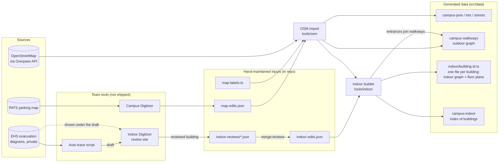
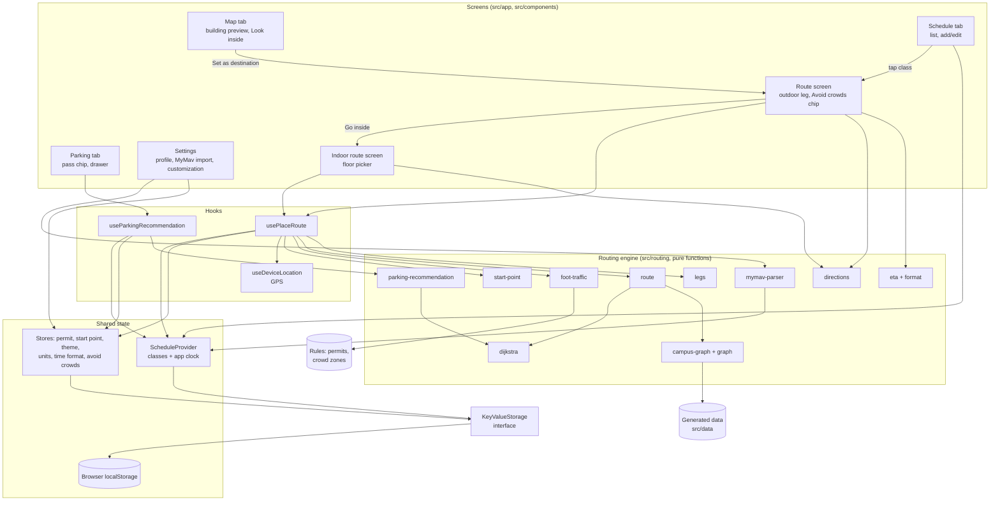
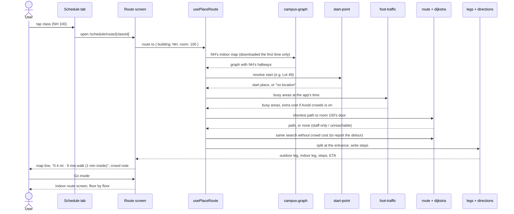

# Mavigator Iteration 3

Team 7
GitHub Repo: [https://github.com/AntoVu/cse3311-fall26-group7](https://github.com/AntoVu/cse3311-fall26-group7)
Evaluated Hash: **[TBD: hash of main after the final merge]**
Live Build: [antovu.github.io/cse3311-fall26-group7](https://antovu.github.io/cse3311-fall26-group7)
Email Reviewer Warning: This written design document and our accompanying Iteration 3 presentation slides have been
emailed to our designated student review team, with the Instructor (Dr. Csallner) and the TA CC'ed. The email was sent
with a subject line beginning exactly with \[CSE 3311 submission\]

Iteration 3 takes indoor navigation from two buildings to **50**, adds the last two features from our inception
document (**Avoid crowds** rerouting and **MyMav schedule import**), and teaches the router which doors the public can
actually use. With that many buildings, each building's indoor map now downloads only when it is first needed, so
the site opens as fast as it did with two. It is still a mobile website built with Expo \[1\], React Native \[2\] and React Native for Web \[3\],
and everything still runs on the phone with no server. This deliverable covers planning and design without going
deep into code; the project's [README.md](https://github.com/AntoVu/cse3311-fall26-group7/blob/main/README.md) has
the full technical detail.

# Project Plan

Iteration 3 finished the inception features. Every user story (US-01 to US-05) and use case (UC-01 to UC-05) now has
a working implementation. Iteration 4 is for polish, user testing and the final demo.

## Team Responsibility Split

| Team Member | Primary Role | Detailed Breakdown |
| :---- | :---- | :---- |
| **Anthony** | Algorithms, data pipeline and integration. | Built the auto-trace script that drafts a building's indoor map from its evacuation diagrams, and the review website the team used to check those drafts. Added door rules (one-way and staff-only doors) and building-to-building doors. Built Avoid crowds, the MyMav import and on-demand loading of indoor maps. Reviewed 7 buildings and merged every review into the app. |
| **Josue** | Indoor review and Android testing. | Reviewed and corrected 13 auto-traced buildings (SWSH, Vandergriff Hall, College Park Center, CAPPA, Science Hall, Central Library, PE, ELB, Ransom Hall, Studio Arts Center, Wetsel, ARDRC, CELB). **[TBD: other work]** |
| **Abiy** | Indoor review, parking and saving. | Reviewed and corrected 15 auto-traced buildings, including Woolf Hall, promised in Iteration 2.5 (Life Science, Pickard Hall, University Center, COBA, MAC, Woolf Hall, University Hall, CPB, Nanotech, Carlisle Hall, EES, ARB, Preston Hall, EHS, LCD). **[TBD: other work]** |
| **Ayesha** | Indoor review, settings and design. | Reviewed and corrected 13 auto-traced buildings (Fine Arts, SEIR, West Hall, Trinity Hall, UAB, The Heights on Pecan, CRB, Hammond Hall, Swift Center, College Hall, Health Center, Texas Hall, Kalpana Chawla Hall). **[TBD: other work]** |

## Changes Since Iteration 2

### Mapping building interiors by script, then by person

Iteration 2 showed that tracing a building by hand does not scale: Nedderman Hall took 14 hours and ERB 7, and UTA
has about 100 buildings. In Iteration 3 we wrote an **auto-trace script** (Python, using PyMuPDF \[30\], RapidOCR
\[31\], scikit-image \[32\], Shapely \[33\] and SciPy \[34\]). It reads each building's evacuation diagrams \[15\],
which are vector drawings, and drafts the indoor map:

* **Rooms:** OCR-read room numbers inside closed walls.
* **Doors:** found from their swing arcs.
* **Hallways:** the center lines of the open space between rooms.
* **Stairs and elevators:** stair treads, elevator boxes and "ELEV" labels.
* **Floors:** each floor is lined up with the building's OpenStreetMap outline \[12\], and floors are joined through
  the stairs and elevators they share.

On NH and ERB, which we had traced by hand, the script found most rooms and doors and placed them about 1 to 2 m from
the hand trace. It drafted 48 more buildings. A draft is not a finished map, so each teammate reviewed their buildings
in the **Indoor Digitizer** \[23\], now published as a website for the team. Iteration 3 added tools to it for fixing
drafts quickly: resize and rotate a selection, square walls to common angles, close the thin gaps the script leaves
between rooms, copy a whole floor onto another, and a per-building checklist of problems to fix.

### Doors are not all public

Some UTA doors open only one way (alarmed exits) or only with a staff keycard. Routes used to pass through them. Every
door in the indoor data now has a rule each way: anyone, staff only, or no one. Routes never use a "no one" door, and
skip staff-only doors. A room that can only be reached through a staff-only door says so instead of drawing an
impossible route.

### Buildings connected to buildings

Some UTA buildings join each other above the ground floor (for example, Science Hall's third floor opens into the
Chemistry and Physics Building). An entrance can now lead straight into another building on any floor, and directions
say "Go into Chemistry and Physics Building".

### Indoor maps load only when needed

Fifty buildings of indoor data made the site's first download almost twice as big: 7.0 MB of JavaScript (1,145 KB
gzipped) instead of about 3 MB (647 KB). Every visitor paid for every building on the first load, even to look at the
outdoor map. Each building's indoor map is now its own file. The site downloads one the first time it is needed:
opening a building's preview, routing to a room in it, or checking a room number when adding a class. The first
download is back to 3.1 MB (710 KB gzipped), and a building's file is 2 to 58 KB gzipped. Mapping more buildings no
longer slows the first load. Routes to a building's door need no indoor data, because entrances are part of the
outdoor walkway graph.

## Iteration 3 (and 2.5) Accomplishments

| Item | Completed in Iteration 3 |
| :---- | :---- |
| US-02 / UC-05: Indoor room navigation | 50 buildings (NH and ERB by hand, 48 auto-traced and reviewed). Every building east of Cooper (promised for 2.5), and the rest of campus (promised for 3) |
| Woolf Hall (carried over from 2.5) | Mapped and routable |
| US-03 / UC-04: Avoid crowds | "Avoid crowds" chip on the route screen. The two places our users named as busy (the walkway west of the Central Library and the one south of the University Center, weekdays 11 AM to 3 PM) are drawn in amber at those times; routes go around them and say how much longer that takes |
| US-05: MyMav schedule import | Paste the MyMav schedule (the week view, or the List View of My Class Schedule); preview the classes found, see what couldn't be imported and why, add them in one tap. Checked against a real paste |
| Door rules | One-way and staff-only doors; "Room N is in a staff-only area" when there is no public way in |
| Building-to-building doors | Entrances into another building on any floor |
| Load time | Each building's indoor map downloads only when needed; the first download stays at 710 KB gzipped with 50 buildings |
| Iteration 2 user feedback (Tan) | Fixed NH routes that went up a floor too high and back down |
| Iteration 2 user feedback (Blaine) | Walkway students actually use from Lot 49 to ERB added, so the route no longer goes down Cooper **[TBD: confirm fixed]** |
| Iteration 2 user feedback (Steven) | Entering a schedule: MyMav import replaces typing each class |
| Parking data | Upgrade Lot 49 outline traced; permit rules for Lots 28, 39, 46, ADAN and the visitor lots (issue #18) **[TBD: confirm the rules are done]** |
| User testing | The five students we interviewed tested the prototype (see "User Feedback") |

## Development Plan

The iterative plan \[22\] still holds, with one change: indoor mapping is no longer the bottleneck, because the script
drafts a building in minutes and a review takes about **[TBD]** hours instead of 7 to 14 for a hand trace. Iteration
4 has no new features on purpose. It goes to the problems users raise and to the risks that are still open.

| Iteration | Due Date | Milestone | Status |
| :---- | :---- | :---- | :---- |
| 1 | 09/20/26 | Working app, outdoor map of part of campus, lots, manual schedule, settings | Done |
| 1.5 | 10/04/26 | Full outdoor campus, start points (US-04), outdoor routing, parking recommendation | Done |
| 2 | 10/11/26 | Schedule, NH and ERB indoor navigation | Done (Woolf Hall moved to 2.5) |
| 2.5 | 10/25/26 | Indoor maps for buildings east of Cooper, Avoid crowds, Woolf Hall | Done in Iteration 3 (the review took until 11/01) |
| 3 (Current) | 11/01/26 | Rest of campus mapped indoors, MyMav import, prototype test with the five interviewed students | Done |
| 4 | 11/15/26 | Polish, fixes from Iteration 3 testing, final demo (see below) | Planned |

**Iteration 4 plan, in order** (highest user value and risk reduction first):

1. Fix the bugs found in Iteration 3 user testing (GitHub issues **[TBD: numbers]**).
2. Make starting a route easier (Daniel and Andy found it confusing in Iteration 2; mock screen below).
3. Let users edit a class, not just delete it.
4. Staff route option: a setting that lets faculty and staff route through keycard doors. The data and the router
   already support it; only the switch is missing.
5. On-site checks of buildings the diagrams may have wrong (R-01, R-04, R-12).
6. Remove the temporary Settings > Developer screen.
7. Final demo.

### Mock screens of planned features

*[TBD: replace these sketches with mock screenshots before submitting. The Iteration 2 presentation feedback asked
for screen designs of planned features.]*

**Easier route start (Iteration 4).** Today a route starts from whatever start point was last chosen, hidden behind
a small chip. The plan asks once, right on the route screen, when no start has been picked:

```
+--------------------------------+
| < Back            Walk | Bike  |
|                                |
|          (campus map)          |
|                                |
| +----------------------------+ |
| | Where are you starting?    | |
| | [ My location (GPS)      ] | |
| | [ My residence: KC Hall  ] | |
| | [ A parking lot...       ] | |
| | [ Drop a pin on the map  ] | |
| +----------------------------+ |
+--------------------------------+
```

**Edit a class (Iteration 4).** Tapping a card in Edit mode opens the same form as Add class, filled in, with Save
and Delete:

```
+--------------------------------+
| Edit class                  X  |
| Course code  [ CSE 3311      ] |
| Course name  [ OOSE          ] |
| Building     [ Nedderman Hall] |
| Room         [ 100           ] |
| Days    Su [M] T [W] Th F Sa   |
| Start [ 1:00 PM ] End [2:20 PM]|
|  [ Delete ]          [ Save ]  |
+--------------------------------+
```

**Staff route option (Iteration 4).** Settings > App Customization gets one switch, "Use staff-only doors". With it
on, a room in a staff-only area routes normally, and the directions name the keycard door.

## Requirements Prioritization (MoSCoW)

| Priority | Requirement | Status after Iteration 3 |
| :---- | :---- | :---- |
| Must | Outdoor campus graph and Dijkstra routing | Done (It. 1.5) |
| Must | Indoor room routing | Done for 50 buildings |
| Must | Schedule with a valid building link | Done (It. 2) |
| Should | Permit parking recommendation with walking ETA | Done (It. 2) |
| Should | Residence and apartment start points | Done (It. 1.5) |
| Could | Settings: units, 12/24 hour, saved data | Done (It. 2) |
| Could | MyMav import, Avoid crowds | Done (It. 3) |
| Could | Staff route option | Iteration 4 |
| Won't | Live lot fullness, live crowd tracking | No public data source; tracking students raises privacy problems |

## Effort Estimates

| Task group | Estimated hours | Actual hours | Commits merged to main (approx.) |
| :---- | :---- | :---- | :---- |
| Auto-trace script | **[TBD]** | **[TBD]** | 0 (not in the repo; see R-10) |
| Indoor Digitizer review tools | **[TBD]** | **[TBD]** | 0 (separate site) |
| Reviewing 48 buildings (whole team) | **[TBD]** | **[TBD]** | **[TBD: one commit per building]** |
| Door rules and building-to-building doors | **[TBD]** | **[TBD]** | ~12 |
| Avoid crowds | **[TBD]** | **[TBD]** | 3 (feature, then the busy areas our users named) |
| MyMav import | **[TBD]** | **[TBD]** | 2 (feature, then the week view from a real paste) |
| Loading indoor maps only when needed | **[TBD]** | **[TBD]** | 1 |
| Iteration 2 feedback fixes, parking data | **[TBD]** | **[TBD]** | **[TBD]** |

## Customers and Users

**Users:** UTA students, the people who walk between classes every day. The five students we interviewed at
inception stand in for them, and they have tested every iteration since:

| Name | Who they are (why they matter) |
| :---- | :---- |
| Tan Nguyen | **[TBD: e.g. commuter, engineering major]**: drives in, has classes in NH |
| Andy Ta | **[TBD]**: commuter |
| Daniel Aguilar | **[TBD]**: lives in a nearby apartment |
| Blaine Smith | **[TBD]**: resident, parks in Lot 49 |
| Steven Dau | **[TBD]** |

**What they want, in their order** (from the inception interviews, unchanged by later feedback): find the room
inside a building, park where their permit allows, the shortest route with an ETA, avoid crowds, import their
schedule automatically, and start from where they live.

**Secondary users:** faculty and staff (Faculty/Staff permit since Iteration 2; staff-only doors in Iteration 4).

**Customer:** there is no paying customer. The team itself, for the course, decides what gets built. UTA (PATS and
Facilities) owns the data we would most like to have: current floor plans and live lot occupancy. We have asked for
it **[TBD: replies?]** (see R-08 and R-10).

## User Feedback

At the end of Iteration 3, we sent the five testers the live site and asked each to (1) import or enter their
schedule, (2) route to a class including the room, (3) try Avoid crowds, and (4) check a parking recommendation.

*[TBD: fill in from the testing sessions. Do not invent feedback. Two or three sentences each, like Iteration 2.]*

| Name | Feedback | What we did / will do |
| :---- | :---- | :---- |
| Tan Nguyen | **[TBD]** | **[TBD]** |
| Andy Ta | **[TBD]** | **[TBD]** |
| Daniel Aguilar | **[TBD]** | **[TBD]** |
| Blaine Smith | **[TBD]** | **[TBD]** |
| Steven Dau | **[TBD]** | **[TBD]** |

**Iteration 2 feedback and what Iteration 3 did about it:**

| Name | Iteration 2 feedback | Iteration 3 response |
| :---- | :---- | :---- |
| Tan Nguyen | An NH route went up a floor too high, then back down | Found the cause: a gap in a floor's hallway sent routes up a stair and back. Fixed the trace, and a data test now fails on any floor split in two **[TBD: confirm]** |
| Andy Ta | Confusing at first, a little unappealing | Route start redesign planned for Iteration 4 (mock screen above) |
| Daniel Aguilar | Starting a route is annoying | Same as Andy |
| Blaine Smith | Lot 49 to ERB goes down Cooper | Traced the missing walkway in the Campus Digitizer **[TBD: confirm]** |
| Steven Dau | Adding a schedule is a pain | MyMav import |

## Competitor Uniqueness

The five related tools from Iteration 2, updated with Iteration 3's features:

| Feature / Capability | Google Maps \[26\] | UTA Static PDF \[16\] | Modii (PATS Portal) \[27\] | UTA Interactive Map \[28\] | MazeMap \[29\] | Mavigator |
| :---- | :---- | :---- | :---- | :---- | :---- | :---- |
| Outdoor pedestrian paths | Yes | No | No | Yes | Yes | Yes |
| Permit-filtered parking | No | No | Partial | No | No | Yes |
| Personal schedule integration | No | No | No | No | Some | Yes (manual or MyMav paste) |
| Indoor room navigation at UTA | No | No | No | No | Not licensed by UTA | Yes, 50 buildings |
| Avoids known busy areas | Live traffic for cars only | No | No | No | No | Yes |
| Knows which doors the public can use | No | No | No | No | Partial | Yes |
| Free, no install, no account | Yes | Yes | Needs UTA login | Yes | Varies | Yes |

**How Mavigator differs:** it is the only one that covers the whole trip: from a student's schedule, to a lot their
permit allows or their home, to the building's best public door, to the room. None of UTA's own tools route to a room.
MazeMap could, but UTA does not license it. **Where competitors are still ahead:** Modii shows live lot occupancy,
which UTA does not publish for us; Google Maps covers everything off campus; and our busy areas are known peak times,
not live crowds.

# Risk Evaluation

Updated probabilities and impacts are the team's proposed values. Exposure = probability × impact. Sorted
highest first.

## Retired Risks

| Risk | Was | Outcome |
| :---- | :---- | :---- |
| R-15 (new): Load time grows with every mapped building | 2.0 (50% × 4) | Retired in the same iteration. With 50 buildings the first download had grown from 647 KB to 1,145 KB gzipped; loading each building's map only when needed brought it back to 710 KB, and more buildings no longer add to it |

## Top Five Risks

| ID | Risk | Category | Probability | Impact | Exposure | Change |
| :---- | :---- | :---- | :---- | :---- | :---- | :---- |
| R-12 (new) | Auto-traced indoor maps have errors the review missed (wrong room number, missing door, a stair on the wrong floor) | Data quality | 50% | 5 | 2.5 | New |
| R-04 | Some rooms or floors cannot be mapped (diagram out of date or missing) | External data | 70% | 3 | 2.1 | Same. Realized for ERB floor 6 and Woolf Hall floor 4 (scanned, no linework) |
| R-10 | Floor plan source is copyrighted (UTA EHS evacuation diagrams \[15\]) | Legal | 20% | 10 | 2.0 | Same, now for 50 buildings |
| R-13 (new) | Real MyMav pages differ from the layout the parser was built for | External format | 30% | 4 | 1.2 | New, and realized once: the first real paste was MyMav's week view, which the parser didn't read. Now handled; was 50% before the team's real pastes |
| R-08 | No indoor plans for remaining buildings | External data | 5% | 20 | 1.0 | Down from 4.0. Diagrams found for every building we mapped |

Below the top five: R-11 web pre-rendering (1.2, kept open: the route and indoor screens opened from the Map tab
take their building from the web address, which the build-time render can't see, so React logs a hydration warning on
first load; the page still works, and Iteration 4 fixes it), R-01 remodel or demolition (1.0), R-06 losing a teammate (1.6 at inception, **[TBD: re-rate]**),
R-14 (new) busy-area times are guesses (60% × 1 = 0.6).

## Risk Mitigation Plans

* **R-12, auto-trace errors (by 11/15):** every draft was reviewed by a person against the diagrams, using the
  review tool's checklist (rooms with no door, stairs that stop on one floor, rooms merged into a hallway). The app's
  data tests catch what can be checked automatically: every room door must be reachable from outside, and no floor may
  be split in two. In Iteration 4 we walk two or three buildings and check room numbers and stairs on site.
* **R-04, unmappable floors (ongoing):** a floor can be marked "can't be mapped"; the app then says so instead of
  drawing an empty floor, and a class on that floor still routes to the building's door. We recheck ERB floor 6 on
  site in Iteration 4.
* **R-10, copyright (by 11/15):** the diagrams, their renders and the auto-trace script that reads them are kept out
  of the public repository; only the traced graph (hallways, doors, stairs) is committed, and the review packs were
  shared privately, one person at a time. Our permission request to UTA EHS **[TBD: sent on / reply]**. If UTA says
  no, the fallback is to put indoor maps behind a UTA login.
* **R-13, MyMav format:** each teammate pasted their real schedule and every failure became a test case. The
  first one did fail (the week view has no end times or titles), and its paste is now a test. The import never drops a class silently; anything it can't place (online, TBA, unknown building)
  is listed with the reason, and the user can still add it by hand.
* **R-08, missing plans:** only a building with no diagram at all remains a gap. We can sketch it on site, as for
  ERB floor 6.

# Requirements

The most important requirements added this iteration, in a format simplified from IEEE 830 \[19\]. The full list is
in `developer_documents/REQUIREMENTS.xlsx`.

| Requirement | Description | Importance |
| :---- | :---- | :---- |
| FR-IND-11 | Every building with an evacuation diagram is mapped indoors and routable (50 buildings). | Takes indoor navigation, our users' top request, from a proof of concept to the whole campus. |
| FR-IND-12 | A route never passes through a door the public cannot open in that direction. A room reachable only through a staff-only door shows a message instead of a route. | A route through a locked door is worse than no route. |
| FR-RTE-10 | With Avoid crowds on, a route goes around busy areas during their peak times when the detour costs less than walking through, and says how much time it adds. | US-03 / UC-04. |
| FR-SCH-08 | Pasting the MyMav "My Class Schedule" page adds its classes, with days, times, building and room, after a preview. Meetings that can't be placed are listed with the reason. | US-05; the top schedule complaint from Iteration 2. |
| FR-IND-13 | An entrance may lead into another building on any floor, and routes may use it. | Real UTA buildings connect this way. |

# Design

All data is generated at build time and all routing runs on the phone, so the app needs no server. This section
follows a simplified IEEE 1016 \[20\].

## Architecture

The Iteration 2 feedback said that drawing many components in one box hides how they work together. Following the
definition the feedback quotes, software architecture is a set of structures, each made of **elements, the relations
between them, and the properties of both** \[35\]. We describe three structures:

**The decision that shapes everything below (NFR-04): all routing runs on the phone, with no server and no paid map
API.** The campus graph is small enough to ship with the page (2,464 outdoor junctions plus the indoor graphs), so a
route takes milliseconds on the phone, works with a weak signal, costs nothing to host, and keeps a student's
schedule on their own phone. We rejected a Google Maps hybrid (API key and cost, and no indoor maps), a backend
server (hosting and upkeep for no gain at campus scale), licensing MazeMap or Concept3D (not ours to use), and the
hand-traced map (865 ft median error). The costs: the outdoor map ships in a 710 KB (gzipped) first download, with each
building's indoor map (2 to 58 KB) downloaded the first time it is opened; map changes need a rebuild; there is no
live data; and saved settings live on one device.

1. **Data pipeline (build time):** how the map data is made.
2. **App components (run time):** the parts of the app and which uses which.
3. **Route request (run time, in order):** what happens when a user asks for a route.

*[TBD: export the three Mermaid diagrams below as images for the submitted document, e.g. at mermaid.live.]*

### Structure 1: Data pipeline (build time)



| Element | Responsibility | Properties |
| :---- | :---- | :---- |
| OSM import (`tools/osm`) | Downloads buildings, lots, streets and walkways in UTA's boundary and applies hand edits | Repeatable: `npm run import:osm`. Overpass responses cached. Prints a report of anything unroutable |
| Campus Digitizer | Names and traces outdoor places over the PATS map | Writes `map-edits.json` only. Georeferenced to 3.5 m median error |
| Auto-trace script | Drafts a building's floors from its evacuation diagrams | Kept out of the repo (it reads copyrighted files). Output is a draft |
| Indoor Digitizer | People review and fix each draft over the diagrams | Draft stored in the reviewer's browser; saves one JSON file per building |
| `merge:reviews` | Combines the reviewed building files into `indoor-edits.json` | One file per building, so reviewers never edit the same file |
| Indoor builder (`tools/indoor`) | Turns traced hallways, doors, stairs and door rules into graph nodes and edges; joins entrances to the nearest walkway | Pure functions, 84+ tests. Drops pieces no entrance reaches and reports them |
| Generated data | What the app loads | Never hand-edited. Carries the ODbL notice. Indoor data is one file per building plus a small index, so the app can download a building only when it needs it |

| Relation | Meaning |
| :---- | :---- |
| Source → tool | Read only; nothing from UTA's files is committed |
| Tool → hand-maintained input | The only way those files change |
| Input → import/builder | The build reads them; it never writes them |
| Indoor builder → walkways | Each public entrance becomes a junction on the outdoor graph, which is what links the indoor and outdoor graphs |

### Structure 2: App components (run time)



| Element | Responsibility | Key properties |
| :---- | :---- | :---- |
| Screens | Show the map, schedule, parking and settings; take touches | React Native components; never compute routes themselves |
| Route screen / Indoor route screen | Draw one route; outdoor leg on the campus map, indoor leg floor by floor | Shared by the Map and Schedule tabs, so a fix lands in both |
| `ScheduleProvider` | Holds the class list and the app's clock | The clock drives class status, parking rules and busy areas |
| Stores (`src/state`) | Permit, start point, theme, units, time format, Avoid crowds | Module-level, shared by every screen; saved through `KeyValueStorage` |
| `KeyValueStorage` (new) | Interface for reading and writing saved values by key. `browserStorage` wraps localStorage; `memoryStorage()` is for tests | Hides which storage is used: tests no longer fake a browser global, and a phone-app storage can be added without changing the code that saves |
| `usePlaceRoute` | **The only caller of the router.** Turns "this building and room" into a route, its two legs and its crowd report | Waits for the destination's indoor map to load, then recomputes when the start, the clock, or Avoid crowds changes |
| `start-point` | Resolves the chosen start (GPS, pin, residence, lot, room) to a place | Stored as a reference, so a map re-import can't move it |
| `graph` / `campus-graph` | Builds the outdoor graph at startup and adds each building's indoor graph when it is first needed (`useCampusGraph`) | Directed: a door's rule can block one direction. Staff-only steps are marked restricted. A building loads once and stays |
| `route` | Snaps both ends to the graph, ends at the best entrance or the room's door | Never snaps GPS onto an indoor node |
| `dijkstra` | Shortest path with a binary min-heap | Orders by cost (room and crowd penalties) but reports real meters |
| `foot-traffic` | Finds which walkways are in a busy area now, and makes them cost more | Busy areas are known peak times, not live data |
| `legs` | Splits a route where it enters the building | Outdoor leg (walk or bike), indoor leg (walk) |
| `directions` | Turns a path into steps ("Take the stairs up to floor 3") | Simplifies the line first (Douglas-Peucker \[18\]) |
| `parking-recommendation` | Ranks lots the permit allows by walking time to the class | One shortest-path tree from the class, not one search per lot |
| `mymav-parser` | Reads a pasted MyMav page into classes | Pure; lists every meeting it can't place, with why |

| Relation | Meaning |
| :---- | :---- |
| Screen → `usePlaceRoute` | Screens ask for a route by destination only; the hook gathers the start, clock and options |
| Hook → engine | Calls pure functions; the engine knows nothing about React or screens |
| Engine → generated data | Read only. The outdoor map loads with the page; a building's indoor map on first use |
| State → `KeyValueStorage` → localStorage | Written after every change, read once the page has loaded (pre-rendering rule). Only `browserStorage` touches localStorage |

### Structure 3: Route request (run time, in order)

What happens when a user taps a class on the Schedule tab:



## Inputs and Outputs

Every input the user or the phone gives the app, and what the app shows in return. Rows marked **(new)** or
**(changed)** are from Iteration 3.

| Feature | Inputs | Outputs |
| :---- | :---- | :---- |
| Map tab | 1: one-finger drag \| 2: two-finger pinch \| 3: tap Legend \| 4: tap a building \| 5: long-press the map \| 6: tap Clear | 1: map pans, stops at the campus edge \| 2: zooms 0.25x to 4x \| 3: color key \| 4: building preview \| 5: pin dropped, used as current location \| 6: pin removed |
| Building preview **(changed)** | 1: Outside / Inside toggle (now any of 50 mapped buildings) \| 2: floor picker \| 3: tap a room \| 4: Set as destination / Set Room \_\_\_ as destination | 1: name, category, abbreviation, outline; the building's indoor map starts downloading \| 2: that floor's rooms, stairs, elevators, restrooms ("Loading the indoor map…" until it arrives) \| 3: room highlighted \| 4: route screen |
| Route screen (outdoor) | 1: destination \| 2: start point \| 3: Walk / Bike \| 4: open the drawer \| 5: Go inside \| 6: back chip | 1: route line to the best public entrance \| 2: distance and ETA \| 3: outdoor ETA changes \| 4: steps \| 5: indoor screen \| 6: previous screen |
| Avoid crowds **(new)** | 1: Avoid crowds chip on / off \| 2: the app's clock and weekday | 1: route goes around busy areas, or walks through when there is no way round \| 2: busy areas drawn in amber only during their peak times \| a note: "Going around the Central Library (busy now), +2 min", "No way around…", "Passes…, busy now", "This walk stays clear" or "No busy areas right now" |
| Start point sheet | GPS permission and position \| a residence, apartment, lot or dropped pin | Route recomputed \| a message if GPS is denied or unavailable |
| Indoor route screen | 1: tap a step \| 2: floor picker \| 3: pinch and pan | 1: that step's floor \| 2: floor plan, route solid on that floor and faded elsewhere \| 3: zooms 1x to 6x |
| Door rules **(new)** | Destination room behind a staff-only or one-way door | Route avoids doors that can't be used that way \| "Room N is in a staff-only area, so there's no public way in." if none can \| gate bars drawn across hallways (red closed, amber staff, blue one way) |
| Schedule tab | 1: day row \| 2: the phone's clock \| 3: tap a class \| 4: Edit, select, Delete (n) | 1: that day's classes \| 2: done, In progress, next class \| 3: route screen \| 4: classes removed |
| Add class form | Course code, name, building, room, days, start and end time | Class added \| errors for empty fields, no day, end before start \| confirmation for an overlap or an unknown room |
| MyMav import **(new)** | 1: pasted text of the MyMav schedule page (week view or List View) \| 2: Read schedule \| 3: Add N classes | 1: (after 2) a card per class: code, name, building, room, days, times, "already on your schedule" for repeats \| "Not imported" list with reasons \| "No classes found…" if nothing matched \| 3: classes added, "Schedule imported: Added N classes", back to the schedule |
| Parking tab | 1: pass chip \| 2: the phone's clock \| 3: open the drawer \| 4: tap a lot | 1: lot colors \| 2: colors follow the time of day \| 3: top three lots \| 4: walk from that lot |
| Settings | Theme \| Time Standard \| Units \| permit \| schedule editor | Whole app updates |
| Saving (web) **(changed)** | Any change to schedule, permit, theme, start point, units, time format or Avoid crowds \| reload | Saved to localStorage, restored after reload \| corrupt data ignored |
| Developer (temporary) | Clock offset \| test class \| start inside NH | Simulated time (also moves busy areas) \| test class \| route starts at a room door |

## Route Calculation

Unchanged from Iteration 2 except for steps 2, 5 and 6:

1. Every tab asks one hook, `usePlaceRoute(target, from)`, for a route.
2. **(new)** The hook loads the destination building's indoor map if it isn't loaded yet (and the start building's,
   for a start inside a room). Until it arrives, the route screens say "Loading the indoor map…".
3. The hook resolves the start point to a coordinate or node.
4. `findRoute` snaps the start to the walkway graph and ends at the building's nearest public entrance, or at the
   room's door.
5. **(changed)** `shortestPath` (Dijkstra \[17\]) runs on a **directed** graph. A door with a rule is one or two
   one-way steps: a "no one" step is left out, and a "staff" step is skipped. When Avoid crowds is on and a busy area
   is active, each outdoor walkway inside it costs 4 times its length, so a 50 m crowd is worth a 150 m detour. Room
   edges still cost an extra 1,000 m. Reported distances are always real meters.
6. **(new)** If no public path exists but one through staff-only doors does, the route screen says the room is in a
   staff-only area. When avoiding crowds, the hook also runs the search without the crowd cost to report what was
   avoided and how many minutes it adds.
7. `splitRoute` cuts the route where it enters the building.
8. `routeDirections` writes the steps, now including "Go into Chemistry and Physics Building" for a door between
   buildings.

## Data Structures (JSON)

Iteration 2's structures (course, graph node and edge, start point, saved settings, route plan, parking
recommendation, indoor door) are unchanged; see the Iteration 2 deliverable. New and changed ones:

*[TBD: render these as PlantUML JSON diagrams \[25\] like Iteration 2.]*

**Graph edge with a door rule (changed).** `access` limits one direction. Here the door opens from A to B for anyone,
and from B to A only with a keycard.

```json
{ "id": "ie5120", "from": "i3301", "to": "i3302", "distanceMeters": 1,
  "access": { "backward": "staff" } }
```

**Door rule in the indoor source data (new).** A door across a hallway (`hallwayDoors`) and a room door
(`DoorAccess`). Values are `anyone` (the default when left out), `staff` or `none`.

```json
{ "key": "g12", "floor": "2", "at": [32.73201, -97.11312],
  "sides": [{ "at": [32.73202, -97.11313] }, { "at": [32.73200, -97.11311] }],
  "pass": { "aToB": "anyone", "bToA": "none" } }

{ "room": "250", "at": [32.73210, -97.11320], "enter": "staff", "exit": "anyone" }
```

**Entrance into another building (new).**

```json
{ "at": [32.73050, -97.11190], "into": { "building": "CPB", "floor": "3" } }
```

**Crowd zone (new),** in `src/constants/foot-traffic.ts`. `bounds` is a north-up box around the busy walkway;
`days` uses 0 = Sunday; minutes count from midnight.

```json
{ "id": "library-mall", "name": "the Central Library",
  "bounds": { "north": 32.73029, "south": 32.72912, "west": -97.11351, "east": -97.1132 },
  "peaks": [{ "days": [1, 2, 3, 4, 5], "startMinute": 660, "endMinute": 900 }] }
```

**Building index entry (new),** in the generated `src/data/campus-indoor.ts`. `links` lists buildings a door leads
straight into, which load along with it; `load` downloads the building's own file.

```json
{ "academic-science-hall": { "links": ["academic-chemistry-physics-building"],
                             "load": "import('./indoor/academic-science-hall')" } }
```

**Crowd report (new, computed, not saved).** What `usePlaceRoute` tells the route screen.

```json
{ "busy": ["library-mall"], "through": [], "avoided": ["library-mall"], "extraMeters": 140 }
```

**MyMav parse result (new, computed).** Classes use the same fields as a manually added class.

```json
{ "classes": [{ "courseCode": "CSE 3311", "courseName": "Object-Oriented Software Eng",
                "buildingId": "academic-nedderman-hall", "roomNumber": "100",
                "days": [2, 4], "startTime": "11:00 AM", "endTime": "12:20 PM" }],
  "skipped": [{ "courseCode": "MATH 3330", "reason": "No set meeting time or room (online or TBA)." }] }
```

From the week view, which lists no end time or course title, the end time is a guess (80 minutes for a
Tuesday/Thursday class, 50 otherwise) and the name is the class type ("Lecture"); the preview shows both.

**Saved settings (changed):** adds `avoidCrowds` (`true` or `false`) to the localStorage keys.

## Screen Transitions

*[TBD: update the Iteration 2 screen-transition figure with: Settings > Your Profile > Schedule > Import from MyMav
(and back to Schedule after Add), the Avoid crowds chip on the route screen (same screen, new state), and the
"staff-only area" message state on both route screens.]*

## Use Cases for Iteration 3 Features

Each covers the normal flow and every exceptional case the code handles.

### Domain model and system sequence diagram

*[TBD: insert the PlantUML domain model (Student, ScheduledClass, Building, Floor, Room, Entrance, StartPoint,
ParkingLot, NavigationSession, Route, DirectionStep) and the SSD for "route to a class" (UC-02 into UC-05, with GPS
as an outside system and branches for GPS denied, room not traced and floor not mapped) made for class homework.]*

### UC-01: Select Parking Permit and Find Parking for the Next Class

**Actor:** student. Implemented in Iteration 2; included so every implemented feature has a use case.
*[TBD: paste the 8-step version, SSD and the selectPermit contract from the homework if preferred.]*

Main flow:
1. The student opens the Parking tab.
2. They tap the pass chip and pick their permit. Every lot is recolored for that permit at the app's time.
3. They open the drawer. The app takes their next class today and ranks the lots the permit allows by walking time
   to that class's building, at the class start time.
4. They tap a lot. The walking route from it to the class is drawn.

Contract for `selectPermit(permit)`: afterwards the student holds `permit` and no other (holds' = holds − {(s, p0)} ∪
{(s, permit)}), the choice is saved, and lot colors follow it on every tab.

Exceptional flows:
* **No permit chosen ("None"):** every lot is red, and the drawer asks for a permit.
* **No class left today:** the drawer says so instead of ranking lots.
* **The class's building is not on the map:** the drawer says so.
* **A lot with no permit rule:** drawn gray, never shown as "not allowed".
* **After 7 PM and on weekends:** every known lot is allowed.

### UC-04: Toggle Traffic Avoidance

**Actor:** student. **Precondition:** a route screen is open with a start point and a destination.

Main flow:
1. The app checks the app's clock against the known busy areas.
2. Busy areas active now are drawn in amber on the map.
3. The student taps **Avoid crowds**.
4. The app recomputes the route with crowded walkways made costlier and draws the new route.
5. The note says which busy areas the route goes around and how many minutes that adds ("Going around the Central
   Library (busy now), +2 min").
6. Tapping the chip again returns the direct route. The choice is saved for next time.

Exceptional flows:
* **3a. No busy area active now:** the note says "No busy areas right now." and the route does not change.
* **4a. No way around** (the destination is inside the busy area, or the detour costs more): the route still walks
  through, and the note says "No way around the University Center, busy now."
* **4b. Avoid crowds off but the route passes a busy area:** the note warns "Passes the Central Library, busy now."
* **4c. Busy areas active, but the direct route doesn't pass them:** "Busy now: the Central Library. This walk stays
  clear."
* **5a. Biking:** the added time uses biking speed.

### US-05: Import Schedule from MyMav

**Actor:** student. **Precondition:** the student can open MyMav.

Main flow:
1. The student opens Settings > Your Profile > Schedule > **Import from MyMav**.
2. Following the on-screen instructions, they copy their whole MyMav schedule page (the week view, or the List
   View of My Class Schedule) and paste it.
3. They tap **Read schedule**.
4. The app shows one card per class: course, building and room, days and times. In the week view, a course that
   meets on Tuesday and Thursday becomes one class meeting on both days.
5. They tap **Add N classes**. The classes are added to the schedule in time order, the app says "Added N classes",
   and returns to the schedule.

Exceptional flows:
* **4a. Nothing recognized:** "No classes found. Copy the whole schedule page and try again."
* **4b. A meeting can't be placed** (online, TBA, or a building not on the map): it is listed under **Not imported**
  with the reason, never dropped silently. The student can add it by hand.
* **4c. A class is already on the schedule:** its card says "already on your schedule", and it is not counted or
  added again. If every class is a repeat, there is no Add button.
* **4d. The student edits the pasted text:** the preview clears until they tap Read schedule again.
* **4e. The week view lists no end time:** the end time is guessed (80 minutes for Tuesday/Thursday, 50 otherwise)
  and shown on the card; the on-screen instructions ask the student to check it.
* **4f. A class is dropped or waitlisted:** listed under Not imported ("Status is Dropped, not enrolled.").

### UC-05 extension: Route to a room behind a restricted door

Main flow as in Iteration 2 (route to a room's door). Exceptional flows added:
* **Only a staff-only door leads to the room:** both route screens show "Room N is in a staff-only area, so there's
  no public way in." and no route.
* **A one-way door is on the shortest path the wrong way:** the route takes the next-best path through doors that
  open that way. Gate bars on the indoor map show why.
* **The room is in a connected building:** the route crosses through the connecting door, and directions say "Go into
  <building>".

## Pages and Features

Only what changed since Iteration 2.

#### **Route screen**

* New **Avoid crowds** chip under the trip summary, with a one-line note on what it is doing.
* Busy areas are drawn as amber boxes over the busy walkways during their peak times.
* A room no public door reaches shows the staff-only message instead of a route.

*[TBD: screenshots: route with Avoid crowds off and on at 12:00 on a weekday (Developer > Clock), past the library.]*

#### **Indoor route screen and building preview**

* 50 buildings have floor plans. Gate bars show doors with rules.
* A building's map downloads when its preview opens; "Loading the indoor map…" shows until it arrives.

*[TBD: screenshots of two newly mapped buildings, e.g. Science Hall and the University Center.]*

#### **Settings > Your Profile > Schedule > Import from MyMav**

* Paste box, Read schedule, preview cards, Not imported list, Add N classes.

*[TBD: screenshots of the import screen before and after Read schedule. Blur any real names or student IDs.]*

## Handled Exceptional Cases

New in Iteration 3 (Iteration 2's list still applies):

* A room reachable only through a staff-only door: message, no route.
* One-way and alarmed doors: never used the wrong way, and never offered as a way in.
* Avoid crowds with no busy area, no way around, or a route that already stays clear: the note says which.
* A crowd zone moved off every walkway (onto a roof or off campus): a data test fails.
* MyMav paste with nothing recognized, with online/TBA/unknown-building meetings, with classes already on the
  schedule, with no end times (week view), or with dropped or waitlisted classes.
* A building's indoor map still downloading: the route screens and the building preview say "Loading the indoor
  map…" instead of drawing a route to the door and then jumping to the room. If the download fails (offline), it is
  tried again the next time the screen opens; the add-class room check skips the room check rather than blocking.
* A floor split into pieces by a tracing gap: the data test fails on any split not listed as known, so the bug behind
  Tan's feedback can't come back unnoticed.
* A room door that no entrance reaches: the data test fails and the import report names it.

# Code

**[TBD: run `git diff --shortstat e82d672 <final hash>` after the last merge.]** As in Iteration 2, most of the added
lines are generated map data (now for 50 buildings), not hand-written code.

| Module | Path | Purpose (new or changed in Iteration 3) |
| :---- | :---- | :---- |
| Foot traffic | src/routing/foot-traffic.ts, src/constants/foot-traffic.ts, src/state/avoid-crowds.ts | Busy areas, their peak times, the crowd cost and the route note |
| MyMav import | src/context/mymav-parser.ts, src/app/settings/profile/import.tsx | Parse a pasted schedule; preview and add |
| Door rules | tools/indoor/indoor.ts, src/routing/graph.ts, src/routing/dijkstra.ts | Import door rules into one-way and staff-only edges; skip them when routing |
| Indoor reviews | indoor-reviews/, `npm run merge:reviews` | One reviewed file per building, merged into indoor-edits.json |
| Saved settings | src/state/key-value-storage.ts, persist.ts, schedule-context.tsx | Saving goes through the `KeyValueStorage` interface instead of localStorage directly |
| Route screens | src/components/routing/ | Avoid crowds chip, staff-only message, gate bars |
| Indoor data | src/data/indoor-edits.json, src/data/indoor/ (one file per building), campus-indoor.ts (the index) | 50 buildings, each its own download |
| Loading indoor maps | src/routing/campus-graph.ts, src/hooks/use-place-route.ts, tools/osm/import.mts | `useCampusGraph` loads a building on first use and adds it to the graph; the import writes one file per building |

## Notable Code

* **Crowd cost, not crowd blocking.** A crowded walkway costs 4 times its length instead of being removed, so a route
  goes around only when going around is cheaper, and still reaches a destination inside the busy area. Distances and
  ETAs shown are the real meters walked.
* **Reporting the detour.** With Avoid crowds on, the hook runs a second search without the crowd cost and compares
  the two, which is how the note knows what was avoided and how many minutes it adds.
* **Directed graph for door rules.** Every edge was usable both ways until Iteration 3. Now a door's rule can drop
  one direction ("no one") or mark it restricted ("staff"). Public entrances are the only ones routes may end at, but
  exit-only doors can still be used to leave.
* **The parser never drops data.** Every meeting it can't place is returned with a reason, so the user always sees
  what was not imported.
* **Indoor maps on demand.** The import writes each building's indoor data to its own module, and the index loads
  it with `import()`, which the web build turns into a separate file. The graph is held in a small store: it starts
  with the outdoor walkways and is rebuilt (a few milliseconds) each time a building arrives, and every screen
  reading it re-renders.
* **One file per reviewed building.** Four people reviewing at once never edit the same file, so there were no merge
  conflicts in the indoor data.

## Code Quality

* **Static analysis:** besides the project's normal lint (0 problems), we ran ESLint \[37\] with typescript-eslint's
  strict type-checked rules \[38\]. It reported 494 problems over 16 rules. We analyzed the riskiest ones (promises
  not awaited, promises passed where a plain function is expected, unbound methods, unsafe enum comparisons)
  **[TBD: and fixed N of them]**.
* **Unneeded code removed:** `src/constants/parking-recommendation.ts` and its test were left over from the old
  parking cards and no screen used them **[TBD: confirm deleted]**.
* **Comments:** every new module starts with a short comment on what it does and why (for example, why a crowded
  walkway costs more instead of being removed).

## Unit Tests

**[TBD: final count after merging.]** At the time of writing: **560** Jest \[9\] tests in **41** files with every
Iteration 3 branch merged, up from 506 in 36 files at Iteration 2. TypeScript \[8\] type check and lint report 0 problems. Tests were written with AI assistance (Claude
\[24\]) and reviewed by the team. Test documentation follows a simplified ISO/IEC/IEEE 29119-3 \[21\].

| Area | New or changed tests in Iteration 3 |
| :---- | :---- |
| Foot traffic (src/routing/\_\_tests\_\_/foot-traffic.test.ts) | Which zones are active by day and time, which walkways a zone's box covers, the crowd cost, the route note for each case |
| Dijkstra and campus routes | Custom edge cost; on the real campus, a route goes around the library at noon on a weekday for a couple of extra minutes |
| MyMav parser | List view, phone layout (one field per line, MWF/TR days), the week view from a real paste (one class across the days it meets, guessed end times, dropped classes skipped), meetings it can't place and why, a meeting listed twice, text that isn't a schedule |
| Indoor builder | Door rules on every door kind, hallway gates, entrances into another building |
| Saved settings (src/state/\_\_tests\_\_/persist.test.ts) | Uses `memoryStorage()` instead of faking the browser's localStorage; new case: no storage available |
| Campus data | Every room door reachable; no unknown split floors; every crowd zone covers a walkway; indoor buildings found by abbreviation or id. These tests load every building's file at once (`loadAllIndoor`) |

# How To Test / Run

The site is at [antovu.github.io/cse3311-fall26-group7](https://antovu.github.io/cse3311-fall26-group7/map). Open it on
a phone. To run the code:

```
git clone https://github.com/AntoVu/cse3311-fall26-group7.git
cd cse3311-fall26-group7
npm install
npx expo start --web --tunnel
npm test        # in a second terminal
```

Open the link the tunnel prints on your phone. The tunnel serves a development build, which loads much more slowly
than the live site; judge speed on the live site. The app is designed for phone screens; on a desktop, use the browser's
device toolbar (F12).

**Trying the Iteration 3 features:**

* **Avoid crowds:** Settings > Developer > Clock, set a weekday at 12:00. Route from Lot 49 to a class past the
  Central Library and tap Avoid crowds on and off.
* **MyMav import:** Settings > Your Profile > Schedule > Import from MyMav, and paste your MyMav schedule page
  (week view or List View).
* **Indoor maps:** tap any academic building on the Map tab and switch the preview to Inside. Its map downloads
  then, not when the site opens (watch the browser's Network tab).

# References

References 1 to 29 are unchanged from Iteration 2 and repeated here so this document stands alone.

### Frameworks and libraries (versions from package.json)

1. Expo SDK 57 and Expo Router, 650 Industries. The project started from the Expo default template (MIT license). [expo.dev](https://expo.dev)
2. React 19.2 and React Native 0.86, Meta. [reactnative.dev](https://reactnative.dev)
3. React Native for Web 0.21. [necolas.github.io/react-native-web](https://necolas.github.io/react-native-web/)
4. react-native-svg 15.15. [github.com/software-mansion/react-native-svg](https://github.com/software-mansion/react-native-svg)
5. react-native-gesture-handler 2.32 and Reanimated 4.5, Software Mansion. [Gesture Handler docs](https://docs.swmansion.com/react-native-gesture-handler/), [Reanimated docs](https://docs.swmansion.com/react-native-reanimated/)
6. @react-native-community/datetimepicker 9.1. [github.com/react-native-datetimepicker/datetimepicker](https://github.com/react-native-datetimepicker/datetimepicker)
7. expo-location 57. [Expo Location docs](https://docs.expo.dev/versions/latest/sdk/location/)
8. TypeScript 6.0, Microsoft. [typescriptlang.org](https://www.typescriptlang.org/)
9. Jest 29 with jest-expo, and react-test-renderer. [jestjs.io](https://jestjs.io/)
10. Playwright, Microsoft. [playwright.dev](https://playwright.dev/)
11. GitHub Actions and GitHub Pages. [GitHub Pages docs](https://docs.github.com/en/pages)

### Data sources

12. OpenStreetMap contributors. © OpenStreetMap contributors, Open Database License (ODbL). [openstreetmap.org/copyright](https://www.openstreetmap.org/copyright)
13. Overpass API. [overpass-api.de](https://overpass-api.de/)
14. UTA Parking and Transportation Services, Student Commuter Zones Parking Map. [PDF](https://www.uta.edu/pats/news/2025/Student-Commuter-Zones-Parking-Map---20262.pdf)
15. UTA Environmental Health and Safety, building evacuation diagrams, retrieved through the Internet Archive Wayback Machine. Source for every indoor map; the diagrams are not in the repository. [web.archive.org](https://web.archive.org/)
16. UT Arlington campus map. Not affiliated with or endorsed by UTA.

### Algorithms and standards

17. E. W. Dijkstra, "A note on two problems in connexion with graphs," Numerische Mathematik, vol. 1, pp. 269–271, 1959.
18. D. H. Douglas and T. K. Peucker, "Algorithms for the reduction of the number of points required to represent a digitized line or its caricature," The Canadian Cartographer, vol. 10, no. 2, pp. 112–122, 1973.
19. IEEE Std 830-1998, IEEE Recommended Practice for Software Requirements Specifications.
20. IEEE Std 1016-2009, IEEE Standard for Information Technology, Systems Design, Software Design Descriptions.
21. ISO/IEC/IEEE 29119-3, Software and systems engineering, Software testing, Part 3: Test documentation.
22. C. Larman, Applying UML and Patterns, 3rd ed., Prentice Hall, 2004.

### Tools

23. Campus Digitizer and Indoor Digitizer. Browser tools built for this project with Claude Code. Not in the app's repository.
24. Claude (Anthropic), through Claude Code. Assisted with code, tests, research and documentation.
25. PlantUML. [plantuml.com/json](https://plantuml.com/json)

### Related apps reviewed

26. Google Maps, Google. [maps.google.com](https://maps.google.com)
27. UTA Parking Finder, built by Modii for UTA PATS. [go.uta.edu/park](https://go.uta.edu/park)
28. UTA interactive campus map, Concept3D. [maps.uta.edu](https://maps.uta.edu)
29. MazeMap. [mazemap.com](https://www.mazemap.com)

### New in Iteration 3

30. PyMuPDF, Artifex. Reads the evacuation diagrams' vector drawings in the auto-trace script. [pymupdf.readthedocs.io](https://pymupdf.readthedocs.io/)
31. RapidOCR (ONNX Runtime). Reads room numbers in the auto-trace script. [github.com/RapidAI/RapidOCR](https://github.com/RapidAI/RapidOCR)
32. scikit-image. Wall regions and hallway center lines in the auto-trace script. [scikit-image.org](https://scikit-image.org/)
33. Shapely. Geometry in the auto-trace script. [shapely.readthedocs.io](https://shapely.readthedocs.io/)
34. SciPy and NumPy. Fitting floors to the building outline in the auto-trace script. [scipy.org](https://scipy.org/), [numpy.org](https://numpy.org/)
35. "Software architecture," Wikipedia. Definition used for the Architecture section. [en.wikipedia.org/wiki/Software_architecture](https://en.wikipedia.org/wiki/Software_architecture)
36. Mermaid. Architecture and sequence diagrams. [mermaid.js.org](https://mermaid.js.org/)
37. ESLint. [eslint.org](https://eslint.org/)
38. typescript-eslint, strict-type-checked configuration. [typescript-eslint.io](https://typescript-eslint.io/)
